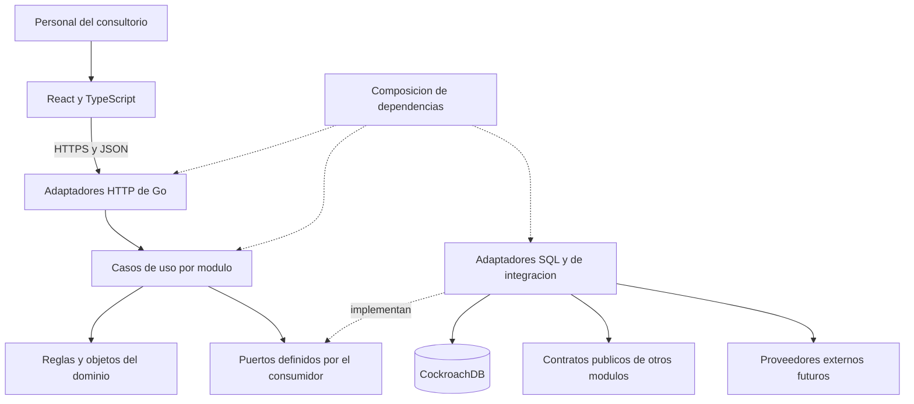

# Fase C — arquitectura general propuesta

Estado: **Propuesto**. Lecturas previas: [contextos](../dominio/02-contextos.md) y [guía de conceptos](guia-conceptos.md). El [ADR 0001](../decisiones/0001-monolito-y-contextos.md) conserva la decisión para revisión.

## 1. Recomendación

Un **monolito modular** en Go, una aplicación React con TypeScript y una base CockroachDB, con propiedad explícita de tablas por módulo. Monolito significa desplegar el backend como una unidad; modular significa que sus capacidades conservan interfaces, datos y reglas propios. Permite aprender y probar partes pequeñas sin administrar múltiples servicios de red.

Aplicar arquitectura **hexagonal de manera selectiva**: la lógica del consultorio no conoce HTTP ni SQL. Los casos de uso llaman puertos pequeños —necesidades que expresan como interfaces— y los adaptadores implementan acceso a datos o a otros módulos. Un formulario simple no necesita seis carpetas, un repositorio genérico y una jerarquía de clases.

## 2. Comparación de opciones

| Criterio | Monolito sin límites explícitos | Monolito modular propuesto | Microservicios |
|---|---|---|---|
| Claridad y mantenibilidad | Fácil al principio; reglas se dispersan | Límites revisables y reglas localizables | Límites fuertes, más contratos y operaciones |
| Desarrollo por capacidades | Cambios suelen cruzar tablas y controladores | Trabajo por módulo y contratos | Trabajo y despliegue independientes si el dominio ya está claro |
| Rendimiento | Llamadas locales | Llamadas locales y transacciones cortas | Red, serialización y fallos parciales adicionales |
| Complejidad y costo operativo | Bajos inicialmente | Moderados y adecuados para equipo pequeño | Altos: despliegues, observabilidad y consistencia distribuida |
| Seguridad | Frecuente acceso indiscriminado | Políticas por caso de uso y datos mínimos | Aislamiento de procesos posible; más superficie y credenciales |
| Testabilidad | Depende de cuánto se mezcle | Dominio y casos de uso con sustitutos; integración separada | Pruebas locales más pruebas entre servicios |
| Evolución funcional | Acoplamiento creciente | Nuevas capacidades sin rehacer el conjunto | Flexible si los límites son correctos, costoso si cambian |
| Infraestructura | Se replica la unidad | Se replica la unidad y se mide antes de extraer | Se ajustan recursos por servicio |

Recomendación: monolito modular. El beneficio actual es claridad y evolución funcional; no se afirma que un consultorio necesite infraestructura distribuida por volumen. CockroachDB es una tecnología prevista por el usuario; PostgreSQL sería una alternativa operativamente razonable si en una revisión se priorizara sencillez de operación, pero no se sustituye silenciosamente la elección.

Tres significados distintos de crecimiento:

- **Escalabilidad del código:** que más cambios y desarrolladores no multipliquen dependencias accidentales.
- **Escalabilidad funcional:** agregar recetas o comprobantes sin rediseñar Pacientes.
- **Escalabilidad de infraestructura:** soportar más carga mediante recursos, réplicas e índices, respaldado por mediciones.

Ninguno se obtiene simplemente por crear carpetas o usar una base distribuida.

## 3. Vista de ejecución y dependencias



El diagrama distingue uso y realización de interfaces. En código, dominio no importa adaptadores; adaptadores conocen los puertos que implementan. El arranque construye esas piezas y las conecta. En VB.NET puede compararse con dejar las decisiones de reserva fuera del evento `Click` y de un `SqlCommand`; Go expresa la separación mediante paquetes, funciones e interfaces pequeñas, sin replicar una arquitectura de clases de .NET.

## 4. Reglas de dependencias

1. `domain` utiliza biblioteca estándar y tipos de negocio propios. No importa `net/http`, `pgx`, SQL, React, DTO de transporte ni otro dominio.
2. `app` coordina dominio y puertos locales; no recibe `*pgx.Conn`, `*sql.Tx` ni solicitudes HTTP como argumentos de negocio.
3. Adaptadores HTTP llaman casos de uso y convierten errores. No deciden si una cita puede solaparse.
4. Adaptadores SQL poseen consultas de su módulo. No consultan o modifican tablas ajenas para saltarse contratos.
5. Un consumidor define la interfaz mínima que necesita; un adaptador de integración la satisface usando la API pública del proveedor. Las firmas públicas contienen identificadores y DTO mínimos, no entidades internas ni objetos del driver.
6. `bootstrap` puede conocer implementaciones de varios módulos para conectarlas. No decide precios, permisos de paciente ni estados de atención.
7. Un coordinador de un proceso entre módulos llama APIs públicas. Ningún módulo lo importa de vuelta. Los coordinadores se crean por proceso concreto, no como un servicio central con todas las reglas.
8. `platform` contiene capacidades técnicas pequeñas. No se admite `shared/entities`, `common/models` ni `utils` como depósito de reglas sin propietario.
9. Cambiar un contrato exige revisar consumidores, pruebas y documentación. Go rechaza ciclos de importación; CI añade restricciones de arquitectura para impedir dependencias acíclicas pero indebidas.
10. No se permite SQL cruzado en reportes por comodidad. Primero consultas coordinadas por contratos; una futura proyección posee sus datos copiados mínimos y su política de actualización.

Dependencias permitidas de ejemplo:

```text
agenda/internal/httpapi -> agenda/internal/app -> agenda/internal/domain
agenda/internal/sqlstore -> agenda/internal/app + agenda/internal/domain
integraciones/agendapacientes -> agenda (API) + pacientes (API)
bootstrap -> APIs de módulos + integraciones + configuración
```

Prohibidas: `agenda -> pacientes/internal/sqlstore`, `clinica/internal/domain -> pgx`, `economia -> clinica` para editar un procedimiento, `web -> DB`, o una interfaz genérica que exponga ejecución de SQL arbitrario.

## 5. Llamadas, eventos y operaciones compuestas

**Llamada directa:** opción inicial para obtener identificación del paciente, estado profesional o ejecutar una reserva. El resultado se necesita de inmediato y una función de Go evita transporte innecesario.

**Evento de dominio:** hecho interno como `CitaReprogramada`, producido por una decisión del modelo. Puede ser una estructura devuelta por el caso de uso; no requiere un bus.

**Evento de integración interno:** publicación estable y mínima para otro contexto, como `ProcedimientoRealizadoRegistrado.v1`. Se produce después de persistir el hecho clínico y solo cuando hay un consumidor real. No transportar el expediente completo.

**Proyección de lectura:** copia derivada para una consulta, por ejemplo un resumen económico por paciente. Se justifica si componer consultas al vuelo resulta costoso; tiene dueño, versión, retraso conocido y posibilidad de reconstrucción. No debe autorizar una prescripción o resolver disponibilidad usando datos obsoletos.

| Operación | Consistencia propuesta | Si algo falla |
|---|---|---|
| Registrar paciente y después reservar | Dos casos de uso y dos confirmaciones; el paciente existe aunque no consiga horario | Mostrar paciente creado y permitir otra reserva; no eliminarlo como compensación |
| Reprogramar una cita | Transacción única de Agenda sobre estado, intervalos, historial e idempotencia | El intervalo original permanece si no se confirma el nuevo |
| Recomendar un control y reservarlo | La necesidad pertenece a Tratamientos; un coordinador reserva con correlación estable | Mantener estado pendiente o pendiente de vinculación y reconciliar; nunca afirmar reserva sin confirmación |
| Finalizar atención y actualizar seguimiento | Finalización de Clínica confirmada; actualización posterior idempotente de Tratamientos | Trabajo durable pendiente y visible; no perder el hecho clínico |
| Registrar pago y emitir comprobante | Pago confirmado en Economía; emisión con ciclo propio | Conservar pago y estado tributario pendiente/rechazado; reconciliar proveedor |

Para una operación entre módulos que **realmente deba ser todo o nada en la misma base**, un coordinador puede usar una unidad de trabajo y adaptadores vinculados a una misma transacción. Cada módulo escribe sus tablas a través de su contrato; el driver permanece en infraestructura. Esta opción acopla la consistencia al despliegue común y debe justificarse por caso. No se implementa una unidad de trabajo universal en el primer recorrido, cuyas escrituras pertenecen a un solo módulo por operación.

Para trabajos posteriores que no deben perderse ante una caída, guardar el hecho y una tarea de salida en la misma transacción (**outbox**). Un trabajador del mismo binario procesa tareas con reintentos y consumidores idempotentes. Invocar otro módulo «después de commit» en memoria, sin registro durable, deja una ventana de pérdida. Tampoco se debe llamar a un proveedor externo dentro de una transacción que puede repetirse.

El primer recorrido no tiene consumidor externo de eventos: no necesita broker, cola distribuida ni outbox genérico. Se incorpora persistencia de tareas cuando se agregue el primer seguimiento o emisión que deba recuperarse de fallos.

## 6. API y frontend

Propuesto: HTTP con JSON y contratos documentados mediante OpenAPI. REST organiza recursos, por ejemplo pacientes y citas; operaciones de negocio explícitas como reprogramar conservan validaciones e historial. La alternativa GraphQL aporta consultas flexibles pero añade autorización por campos y complejidad innecesaria para este primer recorrido; gRPC se reserva para una necesidad real de servicios internos.

El frontend valida formato para ayudar a la persona; el backend decide autorización, elegibilidad y disponibilidad. Ocultar un botón no protege una operación. La sesión se propone mediante cookie segura y mismo origen para interfaz y API; detalles en [seguridad](../seguridad/08-seguridad-y-normativa.md).

## 7. Despliegue inicial y evolución

Propuesta de ejecución: un artefacto Go, archivos estáticos del frontend, HTTPS y CockroachDB con entorno propio. La base administrada reduce trabajo operativo, pero exige revisar ubicación, contrato, copias, costos y transferencias de datos. El autoalojamiento requiere operar la base y su recuperación. Un nodo de desarrollo no demuestra alta disponibilidad de producción.

No se necesitan Kubernetes, Redis, un API gateway separado ni ocho bases de datos para validar el recorrido. Se requieren configuración por ambiente, secretos fuera del repositorio, logs sin contenido clínico, métricas de errores/latencia/reintentos, comprobación de salud y copia restaurable.

Extraer un módulo a servicio exigiría convertir llamadas locales en protocolos de red, resolver autenticación entre servicios, tiempos de espera, repetición, fallos parciales, propiedad de datos, retirada de claves foráneas cruzadas y despliegue independiente. Los límites actuales facilitan ese trabajo, pero no lo hacen gratuito ni justifican hacerlo ahora.

## 8. Principios aplicados con criterio

- **SOLID:** una responsabilidad por capacidad y dependencias hacia necesidades pequeñas. No significa una interfaz por estructura ni una clase por tabla.
- **DRY:** una regla de disponibilidad vive en Agenda. Repetir una validación de formato en navegador y servidor es razonable porque cumplen funciones diferentes.
- **KISS:** llamadas locales, SQL explícito y pocos patrones entendibles.
- **YAGNI:** no anticipar multicliente, un motor de flujos, event sourcing o repositorios genéricos sin una necesidad validada.
- **Arquitectura limpia y hexagonal:** comparten la protección de reglas frente a detalles. Aplicamos esa orientación de dependencias sin duplicar capas con nombres diferentes.

Toda abstracción debe responder qué cambio o prueba facilita hoy. Una interfaz de `PacientesParaAgenda` se justifica porque limita datos y permite una prueba aislada; una interfaz para un cálculo puro de duración no aporta lo mismo.
