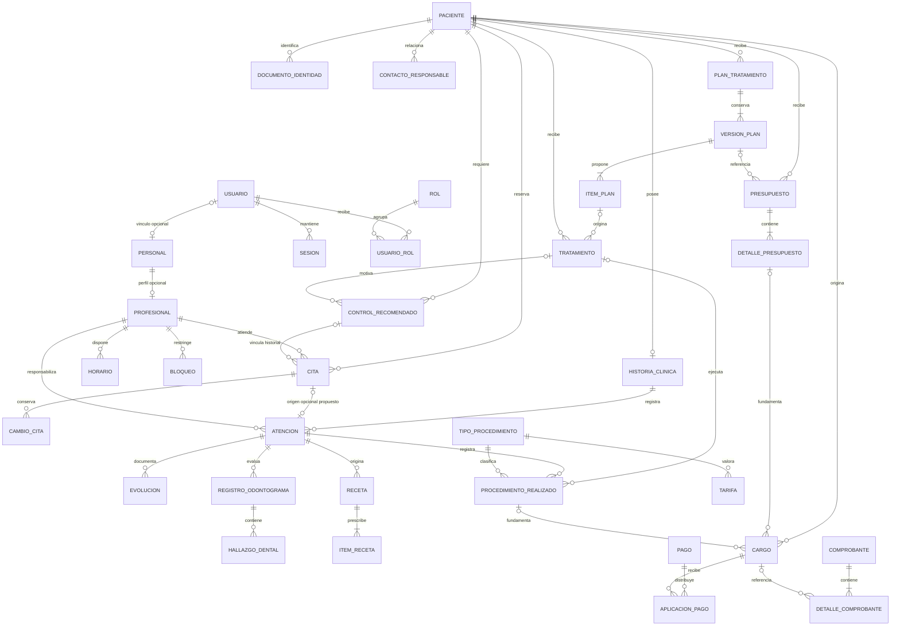

# Modelo conceptual y lógico preliminar

**CHG-008 · 2026-10-17:** migraciones iniciales de CockroachDB 26.2.7 generadas y verificadas: siete versiones, 28 tablas más control de migración, SQL único y scripts de ejecución local. **37 comprobaciones correctas** en nodo aislado con datos ficticios. Autorización/API aún pendientes; las reglas de negocio no confirmadas conservan ese estado. Revisión de impacto pendiente.

[Guía para crear la base local](../../db/README.md). Los antecedentes siguientes conservan su estado histórico.


**Estado vigente · CHG-005 · 2026-10-16:** paciente con DNI u otro documento; campos obligatorios/opcionales según diccionario del usuario. Apoderado para menores y desde los 66 años: nombres/apellidos, parentesco y documento obligatorios. Odontólogo: DNI, nombre, apellidos y especialidad obligatorios. Recepción crea, recibe, cancela, ajusta duración y reasigna por demora (alcance pendiente). Odontólogo gestiona sus horarios y bloqueos; el odontólogo actual es Maestro y también Recepción. **Revisión de impacto pendiente:** estados/responsables de citas, reasignación, conflictos por ausencias y detalles del diccionario. Sustituye parcialmente ADR 0003 en identificación/apoderado y complementa ADR 0004 en permisos; los registros previos se conservan como historia.

Detalle vigente: [ADR 0005](../decisiones/0005-identificacion-y-permisos.md).


**CHG-004 · 2026-10-16 — Confirmado:** recepción ajusta duración; una persona puede tener roles de odontólogo y recepción. Citas de 30 minutos por defecto y como mínimo, ampliables según criterio, sin máximo ni paso fijo acordados. Domingo–viernes: 08:00–12:30 y 15:00–19:00; sábado desde 18:00 hasta 20:00 o 21:00 (cierre por concretar). **Propuesto:** bloqueos fechados por odontólogo para ausencias, sin cancelar automáticamente citas existentes; mostrarlas para gestión explícita. **Pendiente de revisión:** cierre sabatino, permisos de bloqueos/horarios y flujo de citas afectadas. Esta actualización resuelve los pendientes anteriores sobre mínimo, recepción y horario habitual; conserva los demás.

Detalle: [ADR 0004](../decisiones/0004-horarios-roles-y-bloqueos.md).


**Confirmado · CHG-003 · 2026-10-16:** citas de 30 minutos por defecto con duración ajustable; un odontólogo actual y soporte para varios; sin solapamientos por odontólogo; DNI propio obligatorio para todos los pacientes; nombre del padre o apoderado para menores y pacientes de 66 años o más. A los 65 no aplica ese requisito por edad. **Pendiente de revisión:** límites y permisos del ajuste de duración, horarios, evaluación de edad y detalle del vínculo con el apoderado. El dato del apoderado no concede por sí solo permisos de firma o acceso.

Detalle y consecuencias: [ADR 0003](../decisiones/0003-citas-e-identificacion.md). Las propuestas anteriores se leen con esta actualización vigente.


Estado: **Propuesto**. Este documento anticipa la fase D para comprobar los límites de A–C. No es el diseño físico completo ni una migración ejecutable. El diccionario exhaustivo, las restricciones definitivas y los scripts SQL se desarrollarán para el alcance aprobado en D; no se crean todas las tablas por anticipado.

## 1. Motor, versión y propiedad

Base de diseño propuesta: **CockroachDB v26.2.7**, de la serie 26.2 con soporte LTS a partir de ese parche según la política consultada el 14-10-2026. La selección se revisará al implementar y desplegar; se fijará parche/digest probado, no una etiqueta móvil `latest`. [Política oficial de soporte](https://docs.cockroachlabs.com/docs/releases/release-support-policy), [notas de la serie 26.2](https://docs.cockroachlabs.com/docs/releases/v26.2).

Esta entrega verifica documentación, no ejecuta SQL contra un servidor. Tampoco presupone que el protocolo PostgreSQL haga compatibles todas las características de PostgreSQL o SQL Server. Se debe probar cada migración en CockroachDB de la versión seleccionada.

Propuesta: una base y esquemas `identidad`, `personal`, `pacientes`, `agenda`, `clinica`, `tratamientos`, `economia` y `facturacion`, creados cuando se implemente cada capacidad. Un esquema es un espacio de nombres con objetos y privilegios; no es una base independiente. [CREATE SCHEMA en CockroachDB](https://docs.cockroachlabs.com/docs/v26.2/create-schema).

| Alternativa | Ventajas | Limitaciones |
|---|---|---|
| Un esquema compartido con prefijos | Configuración sencilla; herramientas más simples | Propiedad menos visible; errores de acceso cruzado más fáciles |
| Esquemas por módulo, misma base | Nombres y responsabilidad explícitos; facilita permisos técnicos | Misma infraestructura y fallos; migraciones coordinadas; no impide acceso si la cuenta tiene permisos amplios |
| Base por módulo | Mayor aislamiento administrativo | Consultas y transacciones entre propietarios más complejas; innecesario para el MVP |

Los esquemas ayudan a organizar; los límites los refuerzan paquetes, contratos, revisión, privilegios y pruebas. Inicialmente puede existir una identidad SQL de ejecución limitada al conjunto necesario; esto no ofrece aislamiento entre módulos frente a un proceso comprometido. La cuenta migradora tendrá privilegios distintos. Si se requiere separación técnica más fuerte, evaluar conexiones/roles por módulo y su efecto en operaciones coordinadas.

## 2. Diagrama conceptual

Las relaciones representan referencias conceptuales. No todas se convertirán automáticamente en claves foráneas entre esquemas. La lista explícita de relaciones físicas se decide en D.



Cardinalidades propuestas, no reglas confirmadas: una historia por paciente dentro del consultorio; como máximo una atención por cita; una receta tiene al menos un ítem al emitirse. Los borradores pueden estar incompletos. Si una visita requiere varias atenciones profesionales, se revisa la asociación Cita–Atención antes de fijar una unicidad física.

Control–Cita admite historia de varias citas canceladas/reemplazadas; como regla propuesta solo una reserva activa por control. Plan y presupuesto tienen identidades distintas; un presupuesto puede existir sin plan clínico formal. Una atención puede ejecutar procedimientos de varios tratamientos. El responsable de pagar se modelará dentro de Economía y no se deduce necesariamente del paciente.

## 3. Propuesta lógica global por propietario

Notación: `id` es UUID; `*_id` es referencia UUID; `?` indica opcionalidad propuesta. Los nombres enumeran candidatos, no una orden de crearlos todos.

| Propietario / tablas candidatas | Datos centrales | Restricciones y consultas previstas |
|---|---|---|
| Identidad: `usuario`, `credencial`, `sesion` | Cuenta, identificador de acceso normalizado, estado; hash de contraseña si es autenticación local; token de sesión almacenado como hash, expiración y revocación | Acceso único; token único; buscar sesión vigente; nunca guardar contraseña ni token secreto en claro |
| Identidad: `rol`, `permiso`, `usuario_rol`, `rol_permiso`, `recuperacion_acceso` | Códigos de operación; asignación; token de recuperación de uso único | Pares únicos; permisos vigentes; caducidad y consumo atómicos |
| Personal: `personal`, `profesional`, `especialidad`, `profesional_especialidad` | Nombre administrativo, vínculo `usuario_id?`, estado; profesión, colegiatura y evidencia de validación | Vínculo opcional único a usuario en el modelo inicial; perfil conserva historia al desactivarse |
| Pacientes: `paciente`, `documento_identidad`, `contacto_responsable` | Nombre, nacimiento?, contacto?, estado, versión; tipo/número de documento; vínculo y facultades del responsable | Unicidad de documento normalizado cuando corresponda; búsqueda por documento y nombre; DNI del paciente obligatorio; nombre del padre/apoderado obligatorio para menores y desde los 66 años (CHG-003) |
| Agenda: `horario`, `bloqueo`, `control_concurrencia_profesional` | Profesional, vigencia, día/hora local y zona; intervalos de excepción; fila técnica estable y revisión por profesional | Índices por profesional y vigencia; todas las escrituras que cambien disponibilidad participan del protocolo común |
| Agenda: `cita`, `cambio_cita` | Paciente, profesional, inicio, fin, zona, estado, versión, control recomendado?; valores anterior/nuevo, actor, fecha y motivo | Inicio menor a fin; índices de agenda e historial; `version` para cambios concurrentes; no inventar unicidad que resuelva intervalos |
| Agenda: `solicitud_idempotente` | Actor, operación, clave, huella del comando, resultado o referencia, fecha | Unicidad de ámbito+clave; mismo contenido repite resultado; distinto contenido produce conflicto |
| Clínica: `historia_clinica`, `atencion`, `evolucion`, `adenda` | Paciente, número visible y apertura; atención, cita?, autor y tiempo; contenido fechado y estado | Identidad única de historia según alcance; finalizados protegidos; adenda enlaza original |
| Clínica: `antecedente_clinico`, `diagnostico`, `observacion_clinica` | Tipo, presencia/ausencia/desconocido, fuente, valor/unidad, fecha, autor, atención cuando corresponda | Consultar antecedentes vigentes sin perder versiones; no convertir respuestas en diagnósticos automáticamente |
| Clínica: `registro_odontograma`, `hallazgo_dental` | Fecha, autor, versión de convención, estado; pieza, superficie?, código, observación | Reglas de pieza, dentición y símbolos por validar con norma y profesional |
| Clínica: `tipo_procedimiento`, `procedimiento_realizado` | Código/denominación vigente; atención, tipo, pieza?, tratamiento?, ejecutor, fecha y estado | Distinguir catálogo y ejecución; consultas por atención/tratamiento; precios pertenecen a Economía |
| Clínica: `receta`, `item_receta`, `documento_clinico` | Prescriptor, atención, emisión, estado; medicamento, concentración, forma, indicación, cantidad y duración según validación; archivo y metadatos | Campos obligatorios y firma pendientes; archivos privados y trazables |
| Tratamientos: `plan`, `version_plan`, `item_plan`, `tratamiento` | Paciente, objetivos, versión, ítems propuestos, aceptación clínica; tratamiento activo, responsable, remitente?, inicio/fin | Aceptación referencia versión; remitente externo no exige cuenta; no borrar versiones aceptadas |
| Tratamientos: `control_recomendado` | Paciente, tratamiento?, origen clínico?, objetivo, ventana o fecha, estado | Consultar pendientes/vencidos; resultado clínico decide cumplimiento; reserva es un vínculo, no cumplimiento |
| Economía: `tarifa`, `presupuesto`, `detalle_presupuesto` | Tipo de procedimiento, vigencia, precio/moneda; versión, paciente, plan?, condiciones y aceptación; cantidades y descripciones históricas | Cambiar tarifario no altera presupuesto aceptado; total recalculable con redondeo definido |
| Economía: `cargo`, `pago`, `aplicacion_pago`, `ajuste` | Deudor, paciente relacionado, importe/moneda, origen único, vencimiento?; ingreso y medio; asignaciones; reversos | Origen idempotente; importes exactos; aplicación no supera disponibles; historial económico por paciente y deudor |
| Facturación: `comprobante`, `detalle_comprobante`, `intento_emision` | Tipo, emisor, serie/número según proveedor, datos históricos receptor/conceptos, importes, estado, correlación, respuesta | Unicidad fiscal y de solicitud según régimen; consulta de resultado antes de repetir emisión ambigua |
| Infraestructura: `auditoria_acceso`, tareas de salida/recepción cuando hagan falta | Actor, operación, recurso, resultado, fecha, correlación; evento mínimo, intentos, estado | Auditoría restringida; deduplicación de consumidor por evento; no copiar notas clínicas a logs |

No se utilizará una tabla global `persona` como requisito de integridad entre todos los contextos. No se empleará una referencia polimórfica sin restricciones como única garantía de cargos: en D se elegirán referencias concretas y reglas de origen exclusivo, o un registro de origen publicado con integridad explícita.

## 4. Tipos, auditoría y estados

- **Identificadores:** UUIDv4 propuesto. CockroachDB documenta `gen_random_uuid()` con tipo UUID y `unique_rowid()` como alternativa entera. UUID ocupa más que un entero, pero permite crear identidad antes de guardar y distribuir inserciones. Una secuencia visible de historia o comprobante es otro concepto. No se adopta UUIDv7 sin una evaluación específica; no se copia `IDENTITY` o `NEWSEQUENTIALID()` de SQL Server. [UUID oficial](https://docs.cockroachlabs.com/docs/v26.2/uuid).
- **Dinero:** `DECIMAL(18,2)` como propuesta inicial para importes y código de moneda; cantidades, tasas y redondeos requieren precisión separada. No usar `FLOAT` ni números binarios de JavaScript como autoridad del cálculo monetario. PEN es hipótesis de operación local, no confirmación de moneda única. [DECIMAL oficial](https://docs.cockroachlabs.com/docs/v26.2/decimal).
- **Tiempo:** `TIMESTAMPTZ` para instantes; `DATE` para nacimiento y fechas civiles; horas locales y zona para reglas de horario. `TIMESTAMPTZ` no conserva por sí solo el nombre de la zona original. Presentar agenda en `America/Lima` y convertir límites del día a instantes; no fijar manualmente un desplazamiento en todo el código. [Tipos temporales oficiales](https://docs.cockroachlabs.com/docs/v26.2/timestamp).
- **Texto/estados:** códigos explícitos y restricciones de valores; evitar enums rígidos antes de validar transiciones. No usar un booleano para responder preguntas clínicas de tres estados: sí, no y desconocido/no evaluado.
- **Mutables administrativos:** `created_at`, `created_by`, `updated_at`, `updated_by`, `version`. El esquema concreto distingue acciones de usuario y procesos del sistema.
- **Clínicos finalizados y movimientos económicos:** registros históricos con autor/fecha; correcciones mediante adendas o reversos. `updated_at` no constituye historial.
- **Documentos:** metadatos en base y archivos privados en almacenamiento apropiado cuando exista esa capacidad; registrar hash, tipo, tamaño, autor y versión. No guardar toda la historia como un único JSON opaco ni usar JSON para evitar modelar relaciones esenciales.

Estados preliminares: plan propuesto/aceptado/sustituido/cancelado; tratamiento planificado/activo/suspendido/completado/abandonado; control pendiente/reservado/cumplido/cancelado con motivo. «Vencido» puede derivarse de ventana y estado. Clínica: borrador/finalizado y adenda separada. Economía: presupuesto borrador/ofertado/aceptado/vencido/sustituido; saldo derivado de movimientos. Las transiciones definitivas no están aprobadas.

## 5. Integridad y políticas de eliminación

Claves foráneas dentro de cada contexto por defecto. Entre contextos, propuesta pragmática para el monolito: referencias físicas a identidades estables donde aporten integridad, especialmente Cita→Paciente y Cita→Profesional, con eliminación restringida. Solo la clave se considera contrato de persistencia; no autoriza leer columnas privadas. El propietario consumidor solicita y coordina esa migración. [Claves foráneas en CockroachDB](https://docs.cockroachlabs.com/docs/v26.2/foreign-key).

Alternativa: referencias lógicas comprobadas por API y reconciliación. Facilitan separar bases, pero admiten referencias inválidas si se implementan mal. No se eligen por una posible extracción futura todavía hipotética. Las referencias externas a remitentes o proveedores se validan por su propio contrato, no mediante claves a tablas inexistentes.

No habrá borrado en cascada de un paciente hacia su historia, pagos o citas. Desactivar cuenta o personal no elimina autoría. Fusión de pacientes requiere mapa de identidades y trazabilidad, no reasignación masiva improvisada. Retención, anonimización y eliminación excepcional requieren reglas aprobadas según tipo de información; no se decide un período legal en este documento.

| Garantía | Base de datos | Aplicación y protocolo |
|---|---|---|
| Identidad y referencias existentes | PK, FK, `NOT NULL` según columna | Elegibilidad y autorización |
| Documento no duplicado según política | Restricción única normalizada | Tipos, excepciones, corrección y fusión |
| Intervalo válido | Comprobación inicio < fin | Zona, horario vigente, bloqueos, duración y anticipación |
| Ausencia de solapamiento | No basta una unicidad por inicio | Transacción serializable y protocolo de Agenda |
| Pago y cargo con valores permitidos | Comprobaciones de signo/moneda y claves | Sumas, aplicaciones concurrentes y redondeo acordado |
| Estado permitido | Restricción de valores | Transición válida por operación y actor |
| Integridad clínica histórica | Permisos y restricciones de escritura como defensa | Finalización, autoría, adendas y auditoría verificable |

## 6. Reserva concurrente propuesta

Usar intervalos semiabiertos `[inicio, fin)`: una cita que termina a las 10:00 permite otra que empieza a las 10:00. Dos intervalos solapan cuando `existente.inicio < nuevo.fin` y `existente.fin > nuevo.inicio`.

Diseño de aplicación propuesto, aún no implementado:

1. Autenticar y autorizar. Validar forma del comando y preparar identificadores estables e idempotencia. Consultar identificación y elegibilidad profesional mediante contratos; documentar la semántica temporal de esa elegibilidad.
2. Abrir transacción explícita con aislamiento `SERIALIZABLE`.
3. Comprobar o reclamar la clave idempotente dentro de la transacción. La repetición con distinto contenido devuelve conflicto; una respuesta guardada exige nueva autorización del solicitante antes de devolverse.
4. Actualizar la revisión de una fila técnica preexistente por odontólogo en `control_concurrencia_profesional`. Se crea al habilitarlo para Agenda. Es un punto común de conflicto, no una regla clínica ni un agregado que contiene toda la agenda.
5. Leer horarios, bloqueos y citas que ocupan tiempo desde la misma transacción. Rechazar conflicto mediante la comparación de intervalos. No usar caché, réplica de lectura atrasada ni una consulta previa fuera de la transacción como garantía.
6. Guardar cita, historial, revisión e idempotencia y confirmar juntos.
7. Ante `40001`, abortar y repetir toda la unidad con espera creciente, variación aleatoria, límite de intentos y plazo total. Agotado el plazo, responder fallo temporal; no confirmar una reserva inexistente.

CockroachDB puede requerir reintentos explícitos del cliente en transacciones serializables. `SELECT FOR UPDATE` no elimina esa necesidad, y no protege por sí solo un hueco donde todavía no existe ninguna cita. [Errores de reintento](https://docs.cockroachlabs.com/docs/v26.2/transaction-retry-error-reference), [comportamiento de bloqueos](https://docs.cockroachlabs.com/docs/v26.2/select-for-update).

**Obligación del protocolo:** reservar, reprogramar, cancelar, introducir bloqueos y cambiar horarios deben participar del mismo mecanismo. En reprogramación entre profesionales se actualizan ambas filas de control en orden determinista; se excluye la cita modificada al comprobar sus nuevos intervalos. Cambiar horario no elimina citas existentes: debe rechazar incompatibilidades o gestionar una excepción explícita por validar.

La fila por profesional serializa cambios incluso de días distintos: es un costo aceptado para un consultorio pequeño. Si aparece contención real, puede refinarse a profesional/día con cobertura de todos los días afectados, previa prueba. No se añade esa complejidad ahora.

Alternativa: franjas discretas y ocupaciones únicas por profesional/franja. Puede ser robusta, pero obliga a fijar granularidad y fragmentar duraciones. Las duraciones no están confirmadas, por lo que se recomienda intervalos con protocolo transaccional.

No se proporciona sintaxis de restricciones de exclusión importada de PostgreSQL sin comprobar compatibilidad. Tampoco se afirma que un índice por `(profesional_id, inicio)` impida 09:00–10:00 y 09:30–10:30.

Elegibilidad profesional concurrente: verificar «activo» antes de reservar no impide que Personal lo desactive un instante después. Propuesta inicial: la consulta establece elegibilidad al momento de comprobación; una baja crea un trabajo explícito para revisar futuras citas. Si se exige exclusión estricta simultánea entre baja y reserva, ambas operaciones deben coordinarse en una transacción común mediante contratos. Esta regla requiere validación, no una promesa implícita.

Un resultado de commit ambiguo o una desconexión no debe repetirse como si se hubiera abortado con certeza. Resolver mediante clave idempotente y consulta del resultado. Identificadores, tiempo relevante y contenido permanecen estables entre reintentos; no enviar mensajes, emitir comprobantes o cobrar a un proveedor dentro de esa transacción.

## 7. Índices iniciales y consultas

Propuestos: documento de paciente normalizado; nombre normalizado para búsqueda paginada según estrategia a medir; citas por `(profesional_id, inicio)` y por `(paciente_id, inicio)`; cambios por `(cita_id, ocurrido_en)`; bloqueos por profesional e inicio; horarios por profesional y vigencia; control técnico por profesional; idempotencia por ámbito y clave; sesiones por hash y expiración.

Índices futuros: atenciones por historia/fecha; procedimientos por tratamiento/fecha; controles por estado/fecha objetivo; cargos por deudor/estado/vencimiento; aplicaciones por pago y cargo; comprobantes por identificador fiscal y correlación. Verificar planes de consulta y selectividad; no crear índices por cada columna. Para búsqueda por subcadena, un índice B-tree de nombre no basta automáticamente: se evaluará alternativa solo si ese comportamiento es necesario.

## 8. Organización de migraciones

Una secuencia global ordenada con propietario en el nombre, bajo `backend/migrations/`. Evita que dos directorios de módulos ejecuten cambios en orden incompatible. Cada cambio declara dueño, dependencias, compatibilidad, validación y recuperación.

```text
backend/migrations/                    # propuesta, todavía no creada
  000001_identidad_base.up.sql
  000002_personal_base.up.sql
  000003_pacientes_base.up.sql
  000004_agenda_horarios_y_bloqueos.up.sql
  000005_agenda_citas_e_historial.up.sql
  000006_agenda_idempotencia_y_concurrencia.up.sql
  000007_auditoria_operaciones.up.sql
```

Antes de hacer accesible la reserva deben estar aplicadas las restricciones y el protocolo completo, no solo `cita`. Si se usa identidad externa, adaptar la primera migración; los permisos de aplicación siguen teniendo propietario. Los datos de desarrollo serán ficticios y separados de migraciones estructurales.

Seleccionar y probar el ejecutor de migraciones durante H; no introducirlo por nombre sin verificar su manejo de DDL y CockroachDB. La documentación del motor advierte que muchos cambios de esquema no tienen las mismas garantías transaccionales que las modificaciones ordinarias. No envolver indiscriminadamente todo un archivo DDL en una transacción. [Cambios de esquema oficiales](https://docs.cockroachlabs.com/docs/v26.2/online-schema-changes).

Estrategia: expandir → desplegar código compatible → completar datos → verificar → retirar estructura vieja en otra versión. No editar migraciones ya aplicadas. Un `down` se ofrece solo cuando es seguro y su límite está documentado; para pérdida de datos se necesita restauración o una corrección hacia adelante. Comprobar finalización efectiva de trabajos de esquema y recuperación de fallos parciales.

No se incluyen migraciones de Clínica, Tratamientos, Economía ni Facturación en el primer recorrido. Su inclusión posterior parte del modelo conceptual y de las reglas validadas, no de rellenar toda esta lista.


