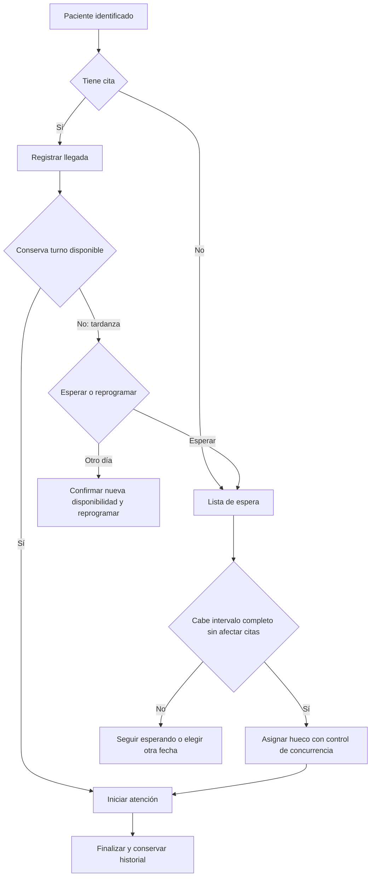

# Diseño técnico del primer recorrido — Pacientes y Agenda

**CHG-015 · 2026-10-18:** alta/búsqueda administrativa de pacientes con documento, apoderado, permisos, auditoría e idempotencia. Nueva migración 011; conservar 001–010. Verificado localmente en CockroachDB 26.2.0 y 26.2.7; revisión de impacto pendiente. [Guía de pacientes](../../backend/PACIENTES.md).

**CHG-008 · 2026-10-17:** migraciones iniciales de CockroachDB 26.2.7 generadas y verificadas: siete versiones, 28 tablas más control de migración, SQL único y scripts de ejecución local. **37 comprobaciones correctas** en nodo aislado con datos ficticios. Autorización/API aún pendientes; las reglas de negocio no confirmadas conservan ese estado. Revisión de impacto pendiente.

[Guía para crear la base local](../../db/README.md). Los antecedentes siguientes conservan su estado histórico.

Fecha: 2026-10-16. CHG-007 / ADR 0007. **Estado: diseño propuesto para revisión**, apoyado en reglas confirmadas de ADR 0003–0006. Autorización del usuario: «Ok, implementalo», referida a diccionario técnico, flujo, permisos y casos de aceptación. La fase D queda diseñada documentalmente; su verificación con migraciones y motor real es una entrega posterior.

Versión de lectura principal: [Diseño técnico en Notion](https://app.notion.com/p/3fc2756ebb4481eb8043c14d6092af51).

## 1. Alcance, evidencia y términos

Recorrido: identificar paciente → reservar → registrar llegada → gestionar espera o reprogramación → consultar agenda → registrar resultado administrativo de atención.

Confirmado: campos del diccionario funcional; apoderado para menores y desde los 66 años; mínimo y valor inicial de cita de 30 minutos; ningún solapamiento por odontólogo; recepción ajusta duración; un odontólogo hoy y varios posibles; odontólogo actual Maestro y Recepción; autogestión de sus horarios/bloqueos; espera sin desplazar reservas o reprogramación ante tardanza.

Las longitudes, catálogos, estados técnicos y responsables operativos que se detallan a continuación son **propuestas**, no nuevas confirmaciones del consultorio. Reglas clínicas, representación legal, facturación y cumplimiento normativo no se cierran con este diseño.

Un diccionario técnico asigna significado, tipo, obligatoriedad y dueño a cada dato. Evita usar DNI como número o perder ceros iniciales. La alternativa de decidir tipos durante cada pantalla produce validaciones contradictorias; por eso se diseña antes del SQL. Una restricción protege un dato o relación en persistencia; la validación del caso de uso protege reglas entre varios registros. Se necesitan ambas: una unicidad por hora inicial no evita una cita 09:00–10:00 y otra 09:30–10:00.

## 2. Convenciones de datos propuestas

- Identidades: UUID interno estable, generado por aplicación; documentos como texto. Nunca reciclar IDs.
- Texto requerido: recortar espacios exteriores y rechazar vacío; preservar grafía, tildes y mayúsculas de presentación. Normalización adicional solo según tipo de documento.
- Tipos SQL aquí son candidatos: UUID, STRING(n), DATE, TIMESTAMPTZ, BOOL, INT8 y JSONB. Sintaxis/índices/aislamiento se verifican en la versión fijada de CockroachDB antes de ejecutar migraciones.
- Fecha de nacimiento sin hora; timestamps como instantes con zona operativa America/Lima. Edad calculada a la fecha local de evaluación; nunca una columna edad que envejezca.
- Mínimo 30 minutos exactos; no se fija máximo ni paso de 15. Para el formulario se propone precisión de minuto, sin grilla obligatoria de medias horas.
- Campos de mantenimiento comunes: id UUID, version INT8 positiva para edición concurrente, creado_en y actualizado_en TIMESTAMPTZ, creado_por y actualizado_por UUID del principal confiable. En tablas inmutables basta actor/fecha del hecho.
- Sin eliminación en cascada de pacientes, profesionales, citas o historial referenciado. Correcciones conservan antes/después y actor. Políticas de retención pendientes, no se presume conservación ilimitada.

## 3. Pacientes — propietario Pacientes

| Registro/campo | Tipo candidato | Nulo | Regla y evidencia |
|---|---|---|---|
| paciente.id | UUID | No | Identidad técnica propuesta |
| paciente.nombres | STRING(150) | No | Confirmado obligatorio; longitud propuesta |
| paciente.apellidos | STRING(150) | No | Confirmado obligatorio |
| paciente.fecha_nacimiento | DATE | No | Confirmado obligatorio; no futura al registrar |
| paciente.estado_civil | STRING(30) | Sí | Opcional confirmado; códigos por validar |
| paciente.ocupacion | STRING(150) | Sí | Opcional confirmado |
| paciente.direccion | STRING(500) | No | Obligatoria; texto inicial sin geografía obligatoria inventada |
| paciente.telefono | STRING(30) | No | Obligatorio; texto, no exigir celular peruano exclusivamente |
| paciente.correo | STRING(254) | Sí | Opcional; validar formato si se informa |
| paciente.estado | STRING(20) | No | Propuesto: activo/inactivo; baja no borra referencias |
| documento_paciente.id/paciente_id | UUID/UUID | No | FK interna a paciente |
| documento_paciente.tipo | STRING(30) | No | Confirmado DNI u otro; catálogo extensible, sin «OTRO» sin descripción de tipo |
| documento_paciente.numero | STRING(40) | No | Documento propio del paciente |
| documento_paciente.numero_normalizado | STRING(40) | No | Derivado por política de tipo, no editable por navegador |
| documento_paciente.principal | BOOL | No | Uno principal por paciente propuesto |

Alta propuesta: paciente y documento principal en una transacción. No aceptar documento vacío. DNI: validar ocho dígitos como propuesta de formato; para otro tipo aplicar su validador configurado, no el de DNI. No integrar consulta oficial de identidad en este alcance.

Índices propuestos: UNIQUE(tipo, numero_normalizado); índice por paciente_id; unicidad condicional del principal cuando se verifique soporte/sintaxis. La existencia de al menos un documento principal se garantiza en el alta/cambios del caso de uso, no con un CHECK que consulte otra tabla. Diferentes tipos con igual número no son necesariamente la misma persona.

Buscar primero por documento y luego por nombres/apellidos con resultados paginados y campos mínimos. Índice de búsqueda textual a elegir y medir antes del SQL; no prometer búsqueda parcial por un índice que solo resuelva igualdad.

Documento duplicado: devolver conflicto y referencia administrativa del paciente existente solo si el usuario tiene acceso. No crear una segunda ficha ni fusionar por teléfono/nombre. Fusión de duplicados e importación masiva quedan fuera del primer recorrido; corrección de documento debe verificar unicidad y auditar el cambio.

### Apoderado y vínculo propuestos

| Registro/campo | Tipo candidato | Nulo | Regla |
|---|---|---|---|
| apoderado.id | UUID | No | Identidad independiente del paciente |
| apoderado.nombres/apellidos | STRING(150) cada uno | No | Nombres y apellidos obligatorios confirmados |
| apoderado.tipo_documento/numero | STRING(30)/STRING(40) | No | Confirmado DNI u otro documento |
| apoderado.numero_normalizado | STRING(40) | No | Unicidad propuesta por tipo+número |
| paciente_apoderado.id | UUID | No | Identidad del vínculo |
| paciente_apoderado.paciente_id/apoderado_id | UUID/UUID | No | FKs internas de Pacientes |
| paciente_apoderado.parentesco | STRING(80) | No | Confirmado obligatorio; permite describir apoderado no familiar |
| paciente_apoderado.desde/hasta | DATE/DATE | Solo hasta | Vigencia propuesta; hasta posterior a desde |
| paciente_apoderado.principal | BOOL | No | Uno principal vigente propuesto |

Un adulto puede ser apoderado de varios pacientes; parentesco pertenece al vínculo. No crear una tabla Persona global para todos los módulos. Documento de apoderado existente permite reutilizar su registro tras revisión, sin sobrescribir datos silenciosamente.

Propuesta operativa: menor = menos de 18; desde 66 años exigir al menos un apoderado vigente con todos los campos. Evaluar al alta y actualización y antes de reservar/registrar llegada, usando la fecha local de la operación. Si falta tras un cumpleaños, pedir completar identificación; conservar las citas existentes y mostrar aviso, no cancelarlas. Este punto y el teléfono compartido con apoderado requieren validación del consultorio. Apoderado no equivale a deudor ni representante legal autorizado automáticamente.

## 4. Personal e Identidad — propietarios separados

| Registro/campo | Tipo candidato | Nulo | Regla |
|---|---|---|---|
| personal.personal.id | UUID | No | Identidad del trabajador |
| personal.personal.nombres/apellidos | STRING(150) cada uno | No | Confirmados para odontólogo |
| personal.personal.usuario_id | UUID | Sí | Referencia a cuenta, asociación única propuesta |
| personal.profesional.id/personal_id | UUID/UUID | No | Perfil único del trabajador |
| personal.profesional.dni | STRING(8) | No | Confirmado obligatorio, unicidad propuesta |
| personal.profesional.estado | STRING(20) | No | Elegibilidad administrativa por contrato; no acredita habilitación |
| personal.especialidad.id/nombre | UUID/STRING(120) | No | Catálogo propuesto, nombre requerido |
| personal.profesional_especialidad | Dos UUID | No | Par único; al menos una especialidad en caso de uso propuesto |
| identidad.usuario_rol | usuario_id/rol_id UUID | No | Par único; admite múltiples roles |
| identidad.rol_permiso | rol_id/permiso_id UUID | No | Asignación por operación, con alcance aplicado en backend |

Se propone admitir varias especialidades sin exigir más de una. Validar «Odontología general» como opción de catálogo; no inventar especialidad para rellenar un obligatorio.

Odontólogo actual: cuenta con Maestro y Recepción. Propuesto: Maestro explícito, nunca derivado del título profesional. Futuro odontólogo no hereda privilegios globales. Identidad publica principal/permisos; Personal publica profesional elegible; Agenda valida alcance profesional propio. Credenciales/sesiones siguen estrategia existente; esta entrega no elige nuevo proveedor de autenticación.

## 5. Agenda — diccionario propuesto

| Registro/campo | Tipo candidato | Nulo | Regla |
|---|---|---|---|
| horario.id/profesional_id | UUID/UUID | No | Propiedad de Agenda; profesional por contrato de Personal |
| horario.dia_semana | INT8 | No | Convención ISO 1=lunes a 7=domingo |
| horario.inicio_minuto/fin_minuto | INT8/INT8 | No | 0–1440, inicio menor a fin, tramos locales de un día |
| horario.desde/hasta | DATE/DATE | Solo hasta | Vigencia; fin exclusivo propuesto |
| horario.zona | STRING(64) | No | America/Lima inicial |
| excepcion_horario.id/profesional_id/fecha | UUID/UUID/DATE | No | Sustituye tramos base solo para esa fecha |
| tramo_excepcion.inicio_minuto/fin_minuto | INT8/INT8 | No | 0 o varios tramos; mismo padre excepción |
| bloqueo.id/profesional_id | UUID/UUID | No | Ausencia de ese odontólogo |
| bloqueo.inicio/fin | TIMESTAMPTZ | No | Inicio menor a fin; varios días posibles |
| bloqueo.motivo/estado | STRING(300)/STRING(20) | No | Activo/retirado propuesto; historial, sin borrar |
| cita.id/paciente_id/profesional_id | UUID/UUID/UUID | No | Referencias estables con pertenencia validada |
| cita.inicio/fin | TIMESTAMPTZ | No | Fin >= inicio + 30 minutos |
| cita.zona | STRING(64) | No | Zona de presentación/operación |
| cita.origen | STRING(20) | No | programada/sin_cita, preservado históricamente |
| cita.resultado | STRING(30) | No | pendiente/atendida/cancelada/no_asistio propuestos |
| cita.ocupa_intervalo | BOOL | No | Reserva liberada deja de competir, sin borrar cita |
| cita.llegada_en | TIMESTAMPTZ | Sí | Hecho independiente del horario y resultado |
| cita.inicio_real/fin_real | TIMESTAMPTZ | Sí | Tiempos administrativos; no duración mínima de atención real |
| espera.id/paciente_id/profesional_id | UUID/UUID/UUID | No | Un profesional solicitado en el alcance inicial |
| espera.cita_origen_id | UUID | Sí | Tardanza con cita, ausencia si vino sin cita |
| espera.llegada_en/motivo | TIMESTAMPTZ/STRING(30) | No | Motivo tardanza/sin_cita |
| espera.estado | STRING(20) | No | esperando/asignada/retirada/cerrada |
| espera.cita_asignada_id | UUID | Sí | Obligatoria si asignada; mismo paciente/profesional |
| cambio_cita.id/cita_id | UUID/UUID | No | Historial inmutable |
| cambio_cita.operacion/motivo | STRING(50)/STRING(300) | No | Acción y razón; actor/fecha del servidor |
| cambio_cita.antes/despues | JSONB/JSONB | Según alta | Solo campos administrativos necesarios; acceso restringido |
| control_profesional.profesional_id/revision | UUID/INT8 | No | Una fila estable por odontólogo |
| solicitud_idempotente | actor, operación, clave, huella, resultado | Según estado | Clave con ámbito; misma intención no se duplica |

Las columnas auxiliares comunes de sección 2 aplican según ciclo de vida. Índices propuestos: cita(profesional_id,inicio), cita(paciente_id,inicio), bloqueo(profesional_id,inicio), horario(profesional_id,dia_semana,desde), espera(profesional_id,estado,llegada_en), cambio_cita(cita_id,fecha), UNIQUE(actor,operacion,clave). No usar UNIQUE(profesional,inicio) como garantía de exclusión.

Para espera, proponer unicidad de entrada activa por paciente/profesional, y verificar coherencia de cita de origen/asignada por restricciones compuestas internas o caso de uso. No reservar tiempo con una entrada de espera.

### Horarios y disponibilidad

Domingo–viernes: tramos 08:00–12:30 y 15:00–19:00. Sábado: apertura 18:00; cierre se debe seleccionar expresamente 20:00 o 21:00 al configurar la fecha/patrón. No asumir el máximo. Las vigencias previenen que editar una semana reescriba el pasado. Una excepción de fecha sustituye al patrón, los bloqueos reducen el resultado y las citas ocupantes se restan después.

Intervalos semiabiertos [inicio,fin): 09:00–09:30 admite 09:30–10:00. Solapan si a.inicio < b.fin y b.inicio < a.fin. Toda reserva cabe en un tramo disponible completo. La atención real puede durar menos o más de 30; no falsear su fin para satisfacer la duración mínima de la reserva.

Mientras alguien siga en atención, no iniciar otra atención con ese profesional aunque haya acabado su hora reservada. Señalar demora y revisar citas afectadas; no moverlas en bloque automáticamente. Una ampliación planificada sí requiere revalidar el intervalo.

## 6. Estados, transiciones y espera propuestos

Se mantienen hechos distintos: resultado de cita, ocupación del intervalo, llegada y ejecución administrativa. La vista deriva etiquetas, evitando mezclar espera con una reserva.

| Acción | Condición | Efecto atómico |
|---|---|---|
| Reservar | Datos completos, profesional elegible, intervalo libre | pendiente, ocupa=true, sin llegada, historial e idempotencia |
| Registrar llegada | Cita no atendida/cancelada; paciente presente | llegada real del servidor; tardanza derivada frente a horario original |
| Liberar por ausencia | Sin llegada ni atención iniciada; operación explícita | ocupa=false; conserva pendiente hasta resolver resultado |
| Entrar en espera | Paciente presente; sin atención iniciada | entrada activa; si conserva reserva incompatible, liberarla con motivo dentro de operación |
| Asignar espera | Hueco completo y persona sigue esperando | reservar/reprogramar, ocupa=true y cerrar entrada asignada en la misma transacción |
| Reprogramar | Sin atención iniciada; nueva disponibilidad | nuevo intervalo; historial del original; ocupa=true; mantener llegada real si ya estaba |
| Cancelar | Sin atención iniciada | cancelada, ocupa=false, cerrar espera vinculada si existe |
| Marcar no asistió | Sin llegada/atención; tras finalizar intervalo, propuesta manual | no_asistio, ocupa=false, historial |
| Iniciar atención | Paciente llegó, intervalo asignado y profesional libre | inicio_real; resultado sigue pendiente; hecho atribuible al profesional |
| Finalizar atención | Atención iniciada | fin_real, atendida; liberar ocupación futura al cierre explícito |
| Rectificar inasistencia | Llegada posterior real y motivo | conservar evento anterior; volver a pendiente y entrar en espera sin restaurar reserva antigua |

No marcar inasistencia automáticamente al minuto de inicio. Una cita cuya hora pasó sigue constando hasta resolución; no mantiene prioridad por encima de citas futuras. Si ya fue marcada no_asistio y luego llega, rectificar con historial; no sobrescribir evidencia. Cita cancelada requiere nueva reserva o espera sin reactivación silenciosa.

Vista derivada: Programada, Pendiente de llegada, Llegó, En espera, En atención, Atendida, Cancelada, No asistió; tardanza como marca adicional. El contrato anterior «reservada» se normaliza aquí a resultado pendiente + ocupa_intervalo=true, mostrado Programada. No se introduce estado «confirmada» sin necesidad operativa.

Bloqueos o cambios de horario con citas: guardar excepción y detectar conflictos bajo el mismo control de profesional; conservar citas, impedir nuevas y mostrar conflicto abierto. El conflicto es una condición de disponibilidad, no cancelación. Resolver explícitamente; retirar bloqueo no revive citas canceladas.

## 7. Matriz de permisos propuesta

C=confirmado por usuario; P=propuesto para cerrar operación; —=sin permiso por defecto. Maestro puede todas las funciones, siempre sujeto a reglas.

| Operación | Recepción | Odontólogo sin otros roles | Maestro | Alcance |
|---|---|---|---|---|
| Buscar/registrar/actualizar paciente y apoderado | P | P | C | Datos administrativos; no historias clínicas por este permiso |
| Consultar agenda | P | C | C | Recepción del consultorio; odontólogo propia |
| Crear cita y ajustar duración | C | — | C | Disponibilidad y mínimo 30 |
| Registrar llegada | C | — | C | Paciente identificado, presencia real |
| Cancelar/reprogramar por demora | C | — | C | Sin atención iniciada |
| Liberar ausencia/gestionar espera/asignar hueco | P | — | C | Actor, motivo y revalidación |
| Marcar/rectificar no asistencia | P | — | C | Condiciones de sección 6 |
| Definir horarios y excepciones | — | C | C | Odontólogo propio; Maestro cualquier profesional |
| Crear/retirar bloqueos | — | C | C | Odontólogo propio; Maestro global |
| Iniciar/finalizar atención administrativa | — | P | C | Profesional tratante; no autoría clínica por rol Maestro |
| Asignar roles/administrar cuentas | — | — | C | Asignación expresa y auditable |
| Borrar historia o alterar atención clínica finalizada | — | — | — | Fuera de este recorrido; trazabilidad obligatoria |

Odontólogo actual reúne Maestro y Recepción; verá las funciones combinadas en una cuenta. La sesión determina actor; nunca un actor_id manipulable del formulario. Verificar operación y recurso en cada caso, incluidos IDs de otros profesionales. Ser Maestro no convierte a alguien en autor clínico de otro profesional.

## 8. Contratos y consistencia propuestos

| Caso de uso | Entradas específicas además del principal | Resultado/errores |
|---|---|---|
| RegistrarPaciente | Datos obligatorios, tipo/número y apoderado condicional, clave | ID+versión; campos incompletos/documento duplicado |
| ActualizarPaciente | ID, versión esperada, cambios, motivo | Nueva versión; conflicto concurrente |
| ConsultarDisponibilidad | Profesional, período, duración>=30 | Huecos informativos; datos inválidos/no elegible |
| ReservarCita | Paciente, profesional, inicio/fin/zona, clave | Cita persistida; horario ocupado/fuera de horario/identificación incompleta |
| ReprogramarCita | Cita, versión, nuevo intervalo, motivo, clave | Nueva versión o conservar totalmente la anterior si falla |
| RegistrarLlegada | Cita, versión, clave | Hora real, sin atención automática |
| RegistrarEspera | Paciente, profesional, cita de origen?, motivo, clave | Entrada activa o existente; rechazo de asociación incoherente |
| LiberarYAsignarHueco | Cita ausente, versión, espera elegida, intervalo, motivo, clave | Cambio de reserva y espera atómicos; ningún solapamiento |
| RegistrarBloqueo/CambiarHorario | Profesional, fechas/tramos, versión, motivo, clave | Persistencia y citas afectadas visibles, sin cancelarlas |
| Iniciar/FinalizarAtencionAdministrativa | Cita, versión, clave | Tiempos/resultados; profesional ya atendiendo/transición inválida |

Agenda consume contratos de Pacientes y Personal; no consulta sus tablas indiscriminadamente. Persistir referencias entre esquemas no autoriza importaciones de implementaciones. Los cambios de elegibilidad profesional concurrentes con una reserva requieren política temporal antes de SQL; no se declara resuelto con una consulta previa.

Cada escritura de disponibilidad actualiza la fila de control del profesional dentro de una transacción serializable, relee estado aplicable y valida solapamientos, guarda historial e idempotencia y confirma. Reintento completo acotado ante error serializable; nunca confirmar éxito antes de commit. Para afectar dos profesionales en una operación futura, orden estable de controles; esa reasignación no forma parte del primer caso confirmado.

Versión esperada protege edición de una cita; control por profesional protege intervalos entre citas. Liberar y ocupar un hueco no se realiza con dos solicitudes independientes que puedan dejar estados parciales. Mientras hay una atención abierta, iniciar otra para el mismo profesional falla bajo el mismo control.

Reglas de unicidad y de al menos un apoderado deben cubrir cambios concurrentes de documentos/vínculos del mismo paciente; proponer control de versión del paciente también al editar sus dependientes. No afirmar que validar solo el formulario preserva consistencia.

Idempotencia: ámbito actor+operación+clave; huella del comando normalizado; mismo contenido devuelve el resultado previo sin repetir; distinto contenido conflicto. Persistir efecto y recibo juntos. Recuperación de resultado no elude revocación de permisos. Retención/caducidad se define antes de implementar, sin valor inventado.

Errores de aplicación propuestos: documento_duplicado, datos_incompletos, horario_ocupado, fuera_de_disponibilidad, version_obsoleta, clave_incompatible, transicion_invalida, profesional_en_atencion, acceso_denegado. Mantener mapeo HTTP del documento de contratos; no filtrar SQL ni detalles clínicos. Propuesta técnica, sin API ejecutable en esta entrega.

## 9. Diagrama de proceso

## 10. Casos de aceptación para implementación futura

Son ejemplos con datos sintéticos y resultados esperados; **no pruebas ejecutadas**.

| ID | Dado/cuando | Resultado esperado | Tipo futuro |
|---|---|---|---|
| PA01 | Alta sin apellido/dirección/teléfono | Rechazo de campos; ninguna alta parcial | Caso de uso/integración |
| PA02 | Alta con correo vacío y estado civil omitido | Aceptada con obligatorios completos | Caso de uso |
| PA03 | Dos altas concurrentes mismo tipo/documento | Una ficha, otra respuesta de duplicado | CockroachDB real |
| PA04 | Igual número con tipos distintos válidos | No fusionar identidades por número solo | Caso de uso |
| PA05 | Menor sin documento propio o sin parentesco/documento de apoderado | Rechazo con campos precisos | Caso de uso |
| PA06 | Adulto de 65 vs 66 en fecha local | Requisito por edad solo desde 66; menores según criterio validado | Caso de uso |
| PA07 | Un apoderado para dos menores | Vínculos distintos sin duplicación obligatoria | Integración |
| PA08 | Cumple 66 con una cita ya guardada | Aviso para completar identificación; cita no cancelada | Caso de uso |
| AG01 | Reserva nueva | 30 minutos por defecto | Interfaz/caso de uso |
| AG02 | Reserva de 29 minutos o fin<=inicio | Rechazo sin persistir | Caso de uso/integración |
| AG03 | 09:00–09:30 y 09:30–10:00 | Adyacencia permitida | CockroachDB real |
| AG04 | Dos solicitudes 09:00–10:00 y 09:30–10:00 mismo profesional | Solo una confirma | CockroachDB real, conexiones independientes |
| AG05 | Dos profesionales disponibles misma hora | Ambas confirman | CockroachDB real |
| AG06 | 12:15–12:45 domingo–viernes | Rechazo por almuerzo | Caso de uso |
| AG07 | Cambio a 45 minutos invade siguiente cita | Conserva intervalo y versión anteriores | Integración |
| AG08 | Reintento misma clave/contenido tras perder respuesta | Misma cita y un solo historial de efecto | Integración |
| AG09 | Misma clave con otro horario | Conflicto, ninguna nueva cita | Integración |
| AG10 | Bloqueo de tres días con citas existentes | Nuevas reservas rechazadas, afectadas visibles y conservadas | Integración |
| AG11 | Reserva y bloqueo concurrentes | Reserva previa al bloqueo aparece afectada; posterior al bloqueo falla | CockroachDB real |
| AG12 | Ausente 09:00, siguiente cita 09:30; espera llega 09:10 | No asignar 30 minutos en hueco de 20 | Caso de uso |
| AG13 | Liberar y asignar hueco con fallo intermedio | Todo revierte; sin sustitución parcial | CockroachDB real |
| AG14 | Tardío llega durante atención de otro | En espera o reprogramado; no desplaza próxima cita | Caso de uso |
| AG15 | Reprogramación falla por conflicto | Cita anterior y espera coherentes; ningún duplicado | Integración |
| AG16 | Atención excede fin planificado | Nueva atención simultánea rechazada; demora visible | Integración |
| AG17 | Retirar bloqueo tras cancelación de cita | No restaurar cita automáticamente | Caso de uso |
| AU01 | Recepción intenta bloquear horario | Denegado con propuesta actual | Autorización |
| AU02 | Odontólogo intenta modificar horario de otro sin Maestro | Denegado por recurso | Autorización |
| AU03 | Cuenta con Maestro+Recepción opera ambos flujos | Permitido y atribuido a la misma cuenta | Autorización |
| AU04 | Maestro intenta reserva solapada | Rechazo por regla de negocio | Integración |
| AU05 | Sesión cambia actor en cuerpo o consulta datos clínicos desde agenda | Actor de sesión; ningún dato clínico expuesto | Seguridad |

Evidencia futura: migración desde cero y actualización, versión/digest de CockroachDB, conexiones independientes, resultados y comandos reproducibles. Pruebas en memoria no demuestran exclusión SQL. No crear tests que solo comprueben que este Markdown contiene estas frases.

## 11. Pendientes y salida de fase

| Pendiente | Propuesta para avanzar | Necesario antes de |
|---|---|---|
| Tipos de documento distintos de DNI | Catálogo explícito de tipos aceptados; no texto sin validar | SQL/alta real |
| Edad y teléfono del menor | Menor <18; contacto puede ser del apoderado; edad al operar | Cerrar alta/reserva |
| Especialidades y apoderados | Varias especialidades; varios vínculos con principal vigente | Restricciones SQL |
| Cierre sabatino | Configurar 20:00 o 21:00 por fecha/patrón | Reservar esos sábados |
| Espera y responsables | Recepción opera espera; odontólogo inicia/finaliza; sin tolerancia automática | Implementar transiciones |
| Citas afectadas por horarios/bloqueos | Conservar, señalar y gestionar; nunca cancelar en lote implícitamente | Implementar disponibilidad |
| Elegibilidad y baja concurrente profesional | Definir garantía temporal con Personal | Persistencia de reserva |
| Paciente con reservas simultáneas en profesionales distintos | No hay decisión confirmada; revisar prevención/advertencia | SQL definitivo del alcance |
| Retención y seguridad del historial/idempotencia | Política de acceso y retención explícita | Entorno compartido/datos reales |

Criterio de salida documental: tablas, transiciones, permisos y ejemplos revisables en un solo diseño, enlazados desde Notion. Criterio de salida completo de fase D: decisiones aplicables validadas y migraciones verificadas contra CockroachDB fijado. Después siguen contratos ejecutables, esqueleto Go/React y primer recorrido con pruebas. Este documento no declara cumplida esa salida técnica.

Fuentes locales: [diccionario funcional](05-diccionario-pacientes-agenda.md), [contratos](../modulos/06-contratos.md), [glosario](../glosario/lenguaje-ubicuo.md), [contextos](../dominio/02-contextos.md), [ADR 0002](../decisiones/0002-propiedad-y-consistencia.md), [ADR 0005](../decisiones/0005-identificacion-y-permisos.md), [ADR 0006](../decisiones/0006-tardanzas-y-espera.md), [ADR 0007](../decisiones/0007-diseno-tecnico-primer-recorrido.md).

