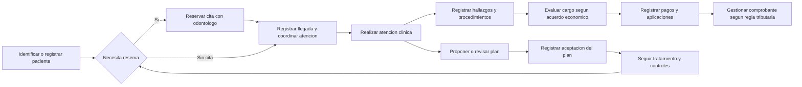

# Fase A — descubrimiento del dominio

**Estado vigente · CHG-005 · 2026-10-16:** paciente con DNI u otro documento; campos obligatorios/opcionales según diccionario del usuario. Apoderado para menores y desde los 66 años: nombres/apellidos, parentesco y documento obligatorios. Odontólogo: DNI, nombre, apellidos y especialidad obligatorios. Recepción crea, recibe, cancela, ajusta duración y reasigna por demora (alcance pendiente). Odontólogo gestiona sus horarios y bloqueos; el odontólogo actual es Maestro y también Recepción. **Revisión de impacto pendiente:** estados/responsables de citas, reasignación, conflictos por ausencias y detalles del diccionario. Sustituye parcialmente ADR 0003 en identificación/apoderado y complementa ADR 0004 en permisos; los registros previos se conservan como historia.

Detalle vigente: [ADR 0005](../decisiones/0005-identificacion-y-permisos.md).

**CHG-004 · 2026-10-16 — Confirmado:** recepción ajusta duración; una persona puede tener roles de odontólogo y recepción. Citas de 30 minutos por defecto y como mínimo, ampliables según criterio, sin máximo ni paso fijo acordados. Domingo–viernes: 08:00–12:30 y 15:00–19:00; sábado desde 18:00 hasta 20:00 o 21:00 (cierre por concretar). **Propuesto:** bloqueos fechados por odontólogo para ausencias, sin cancelar automáticamente citas existentes; mostrarlas para gestión explícita. **Pendiente de revisión:** cierre sabatino, permisos de bloqueos/horarios y flujo de citas afectadas. Esta actualización resuelve los pendientes anteriores sobre mínimo, recepción y horario habitual; conserva los demás.

Detalle: [ADR 0004](../decisiones/0004-horarios-roles-y-bloqueos.md).

**Confirmado · CHG-003 · 2026-10-16:** citas de 30 minutos por defecto con duración ajustable; un odontólogo actual y soporte para varios; sin solapamientos por odontólogo; DNI propio obligatorio para todos los pacientes; nombre del padre o apoderado para menores y pacientes de 66 años o más. A los 65 no aplica ese requisito por edad. **Pendiente de revisión:** límites y permisos del ajuste de duración, horarios, evaluación de edad y detalle del vínculo con el apoderado. El dato del apoderado no concede por sí solo permisos de firma o acceso.

Detalle y consecuencias: [ADR 0003](../decisiones/0003-citas-e-identificacion.md). Las propuestas anteriores se leen con esta actualización vigente.

Fecha: 2026-10-14. Estado: propuesta basada en el encargo, tres formatos inspeccionados visualmente y dos aclaraciones del usuario.

## 1. Problema y alcance

El dominio es la **gestión de la atención odontológica y su continuidad clínica y administrativa**. El consultorio necesita saber quién es el paciente, cuándo debe acudir, qué se propuso y realizó, quién fue responsable y qué importes están pendientes o pagados. Hoy esa información se distribuye en cuadernos y formatos.

DDD, o diseño guiado por el dominio, significa organizar el software alrededor de esas decisiones del negocio. Aquí ayuda a evitar que cada formulario termine convertido en una tabla independiente con información duplicada. La alternativa es diseñar pantallas y tablas primero; puede servir para un registro simple, pero en este proyecto facilita confundir tratamiento, evolución y cobro. La [guía de conceptos](../arquitectura/guia-conceptos.md) desarrolla el significado, problema, alternativa y ejemplo de los términos técnicos.

**Confirmado (CHG-003):** actualmente hay un odontólogo y el sistema debe admitir más. **No está confirmado** el volumen de pacientes, número de sedes, funcionamiento sin internet, presupuesto de infraestructura o atención por aseguradoras. Se propone comenzar con un consultorio y acceso en línea; no se presupone un producto multicliente, múltiples sedes ni operación sin conexión.

## 2. Evidencia de los formatos

Las imágenes están vacías. No se ha extraído información de pacientes reales. Se revisaron como documentos de referencia, no como formularios oficiales validados.

| Evidencia | Secciones observadas | Interpretación propuesta y consecuencia |
|---|---|---|
| [Historia clínica odontológica](../../Imagenes/Historia%20Cl%C3%ADnica%20Odontol%C3%B3gica%20Danber.png) | N.º de historia, apertura, DNI; nombres, nacimiento, edad, sexo, estado civil, ocupación, dirección y contactos | Pacientes posee identificación y contacto. Clínica posee apertura e identificación de la historia. Los datos de filiación pueden aparecer en un documento clínico mediante una copia histórica identificada |
| Misma historia | Motivo de consulta, antigüedad y factores que agravan/alivian | Pertenecen a la atención concreta, no a una propiedad permanente del paciente |
| Misma historia | Enfermedades, alergias, medicación, cirugías, hospitalizaciones, antecedentes familiares y odontológicos, hábitos | Clínica; registrar fuente, fecha y autor. Un campo sin marcar no equivale a ausencia de enfermedad o alergia |
| Misma historia | Signos vitales, examen extraoral e intraoral, odontograma | Hallazgos de una evaluación fechada; requieren unidades y estructura clínica por validar |
| Misma historia | Diagnóstico/plan, observaciones, firma, sello, próxima cita | La presentación reúne varios conceptos: diagnóstico en Clínica, plan en Tratamientos, reserva en Agenda e identidad profesional en Personal |
| [Odontograma](../../Imagenes/Odontograma%20Dental%20Danber%20en%20Espa%C3%B1ol.png) | Identificación, fecha de atención, posiciones dentarias, simbología, observaciones, firma y próxima cita | Registro clínico versionado asociado a una evaluación. La imagen no basta para fijar una codificación normativa |
| [Evolución de tratamiento](../../Imagenes/Formato%20Dental%20Danber_%20Evoluci%C3%B3n%20de%20Tratamiento.png) | Tratamiento, fecha, incidencias, costo, observaciones y firma | Una vista compuesta de actividad clínica e importe económico. No se propone una tabla genérica `evolucion(tratamiento, fecha, incidencias, costo)` como modelo de todo el sistema |

**Confirmación del usuario:** en evolución, «Costo» es el precio o importe del procedimiento realizado. Se propone mostrar «Importe del procedimiento» en pantalla, sujeto a aceptación del vocabulario. Puede existir una atención con varios procedimientos, importes diferentes y varios abonos posteriores.

**Confirmación del usuario:** la reserva requiere solo al odontólogo. El primer modelo de Agenda no tendrá recurso sillón ni consultorio.

Observaciones concretas para validar con el odontólogo:

- El odontograma aportado representa posiciones permanentes; no muestra un conjunto de dentición temporal. La atención de niños, dentición mixta, supernumerarios y superficies dentales necesita aclaración.
- El formato de historia y el odontograma separado no tienen exactamente la misma leyenda. No unificar símbolos por intuición ni asumir que un color identifica por sí solo un diagnóstico o un procedimiento realizado.
- «Diagnóstico/plan» es un título compartido en papel, pero diagnosticar y proponer tratamiento tienen ciclos de cambio diferentes.
- «Fecha de próxima cita» puede expresar una recomendación o una reserva efectiva. Deben verse como estados distintos.
- Fecha de nacimiento permite calcular edad a una fecha. Evitar guardar una edad mutable como fuente maestra; una impresión histórica conserva la edad calculada en el momento del documento.
- N.º de historia y DNI aparecen separados en el formato. El identificador técnico será independiente; la numeración visible requiere revisión normativa y del consultorio.
- Sexo, estado civil, ocupación y hábitos no se convertirán automáticamente en campos obligatorios. Definir finalidad, necesidad, permisos y opciones con responsables clínicos y de protección de datos.
- Una imagen de firma o sello no prueba autoría digital. Definir quién finaliza un registro y cómo se verifica esa acción.

## 3. Actores e identidades

| Actor | Necesidad | Límite propuesto |
|---|---|---|
| Recepcionista | Identificar paciente, reservar, confirmar, reprogramar, registrar llegada y pagos si se autoriza | No necesita acceso general a antecedentes o evoluciones |
| Odontólogo | Evaluar, diagnosticar, realizar procedimientos, prescribir y planificar seguimiento | Acceso clínico por relación asistencial y permisos; no equivale a administrar usuarios |
| Técnico dental | Recibir información necesaria para tareas asignadas | No se presume autorización para prescribir ni acceso completo a historias |
| Administrador | Configuración, personal, cuentas, roles y reportes autorizados | Administrador del sistema no significa lector universal de datos de salud |
| Paciente y responsable | Recibir atención, información y documentos según corresponda | No se presupone un portal de autoservicio en el MVP |
| Profesional remitente | Derivar o recomendar una atención | Puede ser externo y no tener cuenta de usuario ni vínculo laboral |

Usuario, personal y paciente tienen identidades diferentes aunque correspondan a una misma persona. No se crea por anticipado un contexto universal «Personas». Si un odontólogo también es paciente, no se mezclan sus permisos con su historia clínica.

## 4. Procesos por conversar con el consultorio

Las flechas representan un recorrido posible. No obligan a cobrar después de la atención: anticipos, cuotas o cargos por aceptación del presupuesto son decisiones pendientes. Tampoco obligan a emitir un comprobante solo después de un pago; ese momento debe revisarse según la operación tributaria.

Ejemplo ficticio: Ana consulta, acepta un plan de ortodoncia y acuerda un presupuesto. Se inicia un tratamiento que tendrá muchos controles. Cada control recomendado puede terminar en una cita; una inasistencia deja pendiente el seguimiento. Una atención puede registrar un ajuste y su importe, pero el pago de ese día puede cancelar una deuda anterior. El profesional que hace el ajuste puede ser distinto de quien derivó a Ana.

## 5. Reglas iniciales y certeza

| ID | Regla o hipótesis | Estado y origen |
|---|---|---|
| R01 | «Costo» identifica el importe del procedimiento, no el abono | **Confirmado**, respuesta del usuario |
| R02 | Solo el odontólogo es recurso de reserva | **Confirmado**, respuesta del usuario |
| R03 | No se permiten citas solapadas para un mismo odontólogo | **Confirmado**, usuario, CHG-003; no atiende dos pacientes a la vez |
| R04 | Una cita debe tener inicio anterior a fin y una zona horaria definida | **Propuesto**, integridad temporal |
| R05 | Cancelar o reprogramar conserva quién, cuándo y motivo | **Propuesto**, trazabilidad |
| R06 | Se puede atender sin cita | Capacidad **solicitada**; flujo y responsabilidades **pendientes** |
| R07 | Un registro clínico finalizado se corrige mediante una adenda vinculada | **Propuesto**; procedimiento y validez por revisar |
| R08 | Un presupuesto aceptado no se modifica silenciosamente al cambiar el tarifario | **Propuesto**, integridad económica |
| R09 | Aceptar un presupuesto no produce deuda automáticamente | **Propuesto** hasta definir el hecho que origina cada cargo |
| R10 | Anular un pago conserva un movimiento de reversión | **Propuesto**, conciliación y trazabilidad |
| R11 | Un control recomendado no es una reserva confirmada | **Propuesto**, evita citas ficticias a meses o años |
| R12 | Documentos y números de historia no son claves primarias técnicas | **Propuesto**; reglas de unicidad y numeración por validar |

La solicitud confirma que debemos analizar todas las capacidades enumeradas, no que todas pertenezcan al primer lanzamiento. Las dudas y responsables de validación están en el [roadmap](../09-roadmap-y-validaciones.md).

## 6. Clasificación de subdominios

Un subdominio es una parte del problema del negocio; un contexto es un límite del modelo que elegimos para resolverlo. No son necesariamente uno a uno.

| Clasificación propuesta | Subdominios | Justificación |
|---|---|---|
| Principal o core | Atención odontológica longitudinal y continuidad de tratamientos | La integridad del registro, relación entre procedimientos y seguimiento representan el conocimiento específico del consultorio |
| De apoyo o supporting | Pacientes, organización del personal, agenda y gestión económica | Permiten operar y requieren ajustes locales, aunque no son el conocimiento clínico central |
| Genéricos o generic | Autenticación, gestión técnica de sesiones, entrega de notificaciones, almacenamiento documental y mecanismo de emisión tributaria | Conviene aprovechar componentes probados o proveedores, manteniendo en Danber las reglas y contratos que le pertenecen |

La clasificación core es una hipótesis estratégica, no una declaración de ventaja competitiva demostrada. Si la principal diferenciación futura fuese la agenda de varias sedes, esta clasificación se revisaría. «Genérico» tampoco significa poco importante: la seguridad exige rigor aunque no se invente un sistema criptográfico propio.

