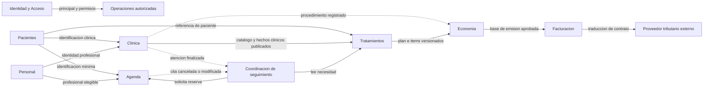

# Fase B — capacidades, contextos y límites

**CHG-007 · 2026-10-16:** diseño técnico del primer recorrido elaborado por instrucción del usuario. Diccionario con tipos/obligatoriedad, relaciones y restricciones; flujo/transiciones; matriz de permisos y casos de aceptación. Estado del diseño: **Propuesto; revisión de impacto pendiente**. No equivale a migraciones verificadas ni aplicación implementada. Los antecedentes siguientes conservan su historia; para concretar implementación consultar el diseño vigente.

[Leer el diseño técnico vigente](../base-datos/06-diseno-tecnico-pacientes-agenda.md).

Estado: **Propuesto**, sujeto a revisión con el consultorio. Un bounded context es un ámbito donde un modelo y sus palabras tienen significado estable. Un módulo es la unidad de código con la que lo implementaremos; para comenzar se propone un módulo por contexto, sin afirmar que esa correspondencia sea obligatoria en DDD.

Separar Clínica de Economía permite discutir «procedimiento realizado» y «cargo» sin hacer que finalizar una evolución dependa de haber cobrado. La alternativa de un único modelo para todos los formatos reduce carpetas inicialmente, pero mezcla permisos, estados y correcciones. La separación tiene un costo: contratos, coordinación y pruebas.

## 1. Mapa de capacidades y propiedad

| Contexto propuesto | Capacidades que reúne | Propietario de | Fuera de su responsabilidad |
|---|---|---|---|
| Identidad y Acceso (`identidad`) | Cuentas, autenticación, credenciales, recuperación, sesiones, roles y permisos | Usuario, sesión, asignaciones de acceso | Datos laborales, habilitación profesional, historia clínica |
| Personal (`personal`) | Registro del equipo, perfiles profesionales, especialidades y estado administrativo | Personal y perfil profesional; asociación opcional a usuario | Contraseñas, horario reservable, diagnóstico |
| Pacientes (`pacientes`) | Identificación, búsqueda, contacto, responsables y estado administrativo | Paciente, documentos y contactos responsables | Alergias, diagnósticos, recetas o saldos |
| Agenda (`agenda`) | Horarios, disponibilidad, bloqueos, reservas, confirmación, reprogramación, cancelación, llegada e inasistencia | Cita, horario, bloqueo, historial de cita | Decidir la necesidad clínica del control, realizar la atención |
| Clínica (`clinica`) | Historias, atenciones, antecedentes, exámenes, odontograma, evolución, diagnósticos, procedimientos realizados, recetas y documentos clínicos | Hechos clínicos y su trazabilidad | Tarifas, cobros, planificación de largo plazo |
| Tratamientos (`tratamientos`) | Planes versionados, aceptación clínica, tratamientos activos, seguimiento y controles recomendados | Intención clínica y continuidad | Disponibilidad, prescripción, recepción de dinero |
| Economía (`economia`) | Tarifario, presupuestos, cargos, cuentas por cobrar, pagos, aplicaciones, ajustes | Acuerdos y movimientos económicos | Modificar hechos clínicos o certificar emisión tributaria |
| Facturación (`facturacion`) | Emisión tributaria, estados del proveedor, respuestas, notas de crédito cuando procedan | Comprobante y sus intentos/resultados de emisión | Saldo clínico, ejecución de tratamiento o registro de pagos |

Auditoría técnica, configuración y envío de recordatorios son capacidades transversales o adaptadores. No se convierten de entrada en contextos autónomos ni servicios desplegados.

## 2. Fichas de los límites

### Identidad y Acceso

**Reglas propuestas:** una cuenta suspendida no inicia sesión ni conserva sesiones utilizables; cada operación exige autorización; recuperar acceso invalida tokens de recuperación usados. Conservar eventos de acceso y cambios de privilegios sin registrar secretos.

**Contratos:** autenticar sesión, consultar principal y permisos, revocar sesiones. El contexto consumidor decide si la operación está permitida sobre ese paciente, atención o pago. Identidad no necesita conocer todas las reglas clínicas.

**Decisión:** Administración de Usuarios, entendida como cuentas, roles y credenciales, pertenece aquí. Administración de Personal se separa porque una persona puede trabajar sin cuenta y una cuenta técnica no es un odontólogo. Una pantalla administrativa puede coordinar ambos mediante contratos.

### Personal

**Reglas propuestas:** registrar cambios de estado y datos profesionales; evitar que un permiso informático suplante la habilitación profesional. No borrar a un profesional referenciado en atenciones.

**Contratos:** `ObtenerProfesionalParaAgenda` y `ObtenerIdentidadProfesionalParaRegistro`. Publican identidad mínima, estado y versión, no datos laborales completos. Horarios pertenecen a Agenda porque allí se resuelve la disponibilidad.

**Pendiente:** cómo verificar y actualizar colegiatura/habilitación, múltiples especialidades y profesionales externos. El remitente externo puede registrarse como una referencia clínica con datos históricos sin crear un empleado ficticio.

### Pacientes

**Reglas propuestas:** identidad interna estable, normalización de documento por tipo, alta provisional cuando una regla validada lo permita, fusión controlada de duplicados. No deduplicar por coincidencia de nombre o teléfono automáticamente.

**Contratos:** `ObtenerPacienteParaCita`, `ObtenerIdentificacionClinica` y búsqueda paginada mínima. No devolver antecedentes médicos en estos contratos.

**Pendiente:** documentos admitidos, pacientes sin documento, menores, quién puede representar y recibir documentos o ser deudor. Una relación familiar no prueba representación legal.

### Agenda

**Reglas propuestas:** intervalo válido; disponibilidad revalidada al reservar; reserva ordinaria no solapada para el mismo odontólogo; reprogramación atómica respecto al intervalo anterior. Todas las modificaciones conservan autor y motivo cuando corresponda.

**Entidades/conceptos:** Cita es candidata a raíz de agregado para su estado. Horario y Bloqueo tienen sus propios ciclos; disponibilidad y agenda son cálculos/consultas. La exclusión entre varias citas se protege además con una política transaccional, no solo con métodos de una Cita aislada.

**Estados preliminares:** reservada, confirmada, llegada, cancelada, no asistió, atendida. No «reprogramada» como estado permanente: reprogramar es un cambio de intervalo con historial. Reglas de transición, tardanzas y sobreturnos pendientes. En el primer recorrido no se habilitan excepciones de sobreturno hasta definir autorización y capacidad.

### Clínica

**Reglas propuestas:** cada atención tiene paciente, fecha y profesional responsable; finalización y corrección trazables; hallazgos negativos, positivos y desconocidos distinguibles; contenido finalizado no se sobrescribe. Acceso clínico por operación y relación asistencial.

**Agregados candidatos:** Atención, RegistroOdontograma y Receta. HistoriaClínica mantiene identidad y metadatos; no se carga toda la vida clínica como un único agregado para añadir una nota. Antecedentes mantienen fecha, autor y fuente, y no solo un booleano actual.

**Decisión:** recetas permanecen aquí porque comparten paciente, atención, autoría y autorización clínica. Se separarán si aparece un flujo de dispensación, integración farmacéutica o equipo independiente que lo justifique. El catálogo de tipos de procedimiento clínico pertenece aquí; Economía referencia sus identificadores y conserva descripciones económicas históricas.

### Tratamientos

**Reglas propuestas:** separar versión propuesta, aceptada y sustituida de un plan; conservar qué fue aceptado; registrar cambios de responsable sin alterar la autoría pasada. Un tratamiento puede extenderse por varias atenciones. Un control pendiente no se considera cumplido solo porque tuvo una cita.

**Contratos:** publicar referencia de plan e ítems; recomendar controles; aplicar resultado clínico resumido al seguimiento. Una atención puede ejecutar procedimientos de varios tratamientos; por eso la asociación se realiza por procedimiento realizado cuando sea necesario.

**Decisión:** controles recomendados viven aquí, incluso un seguimiento aislado del paciente sin tratamiento activo. La necesidad clínica se origina en la atención o el plan, Agenda reserva y Clínica registra lo ocurrido. No se crea un noveno contexto «Controles».

### Economía

**Reglas propuestas:** dinero con importe exacto y moneda; precios acordados inmutables por versión; cada cargo tiene hecho de origen único; aplicaciones no superan pago disponible ni deuda aplicable; reversos conservan historial. Un procedimiento puede tener precio cero según acuerdo, sin inventar una deuda.

**Separación interna:** Tarifario ofrece referencias; Presupuestos conserva ofertas; Cobranzas controla cargos, pagos y aplicaciones. Son capacidades distintas bajo un propietario inicial. No se usa un «estado económico del tratamiento» para sustituir esos conceptos.

**Pendiente:** descuentos, anticipos, cuotas, moneda, impuestos, vencimientos, reembolsos y cuándo nace cada obligación. No descontar dos veces por asociar tanto un presupuesto como un procedimiento al mismo cargo.

### Facturación

**Reglas propuestas:** conservar identificación del documento e intentos de emisión; impedir doble emisión por repetición de solicitud; distinguir preparado, pendiente, enviado, aceptado, rechazado o resultado desconocido según proveedor. Una respuesta HTTP exitosa del proveedor no equivale necesariamente a aceptación tributaria.

**Decisión:** límite explícito desde el diseño, implementación posterior. El contrato recibe conceptos e importes tributariamente pertinentes y versiones, sin historiales clínicos completos. Una emisión rechazada no borra el pago ni el procedimiento; se registra y resuelve su propio problema.

## 3. Context map

Las flechas continuas van del **proveedor de un contrato al consumidor**. Las discontinuas representan hechos comunicados después de guardar una operación; no representan imports de Go ni colas obligatorias.

Relación principal: proveedor/consumidor dentro del mismo equipo, con contratos publicados y revisión conjunta de cambios. El adaptador tributario es una **capa anticorrupción**: traduce términos y estados del proveedor para evitar que sus detalles contaminen Economía. No se propone un núcleo compartido de entidades clínicas y económicas.

## 4. Alternativas relevantes

| Alternativas | Recomendación | Consecuencia y señal para revisar |
|---|---|---|
| Unir cuentas y personal / separar | Separar responsabilidades y módulos | Dos identidades y coordinación de alta/baja; evita usuarios empleados obligatorios |
| Unir Clínica y Tratamientos / separar | Separar modelos en módulos del mismo proceso | Más contratos; útil para atención efectiva frente a planificación longitudinal. Si el flujo real es mucho más simple, pueden convivir en un módulo conservando conceptos |
| Recetas aparte / dentro de Clínica | Dentro de Clínica | Menor coordinación; extraer solo con necesidades de prescripción/dispensación más amplias |
| Control como cita futura / necesidad independiente | Necesidad en Tratamientos + reserva en Agenda | Permite controles sin fecha exacta y seguimiento tras inasistencia; requiere vínculo y reconciliación |
| Tarifario, Presupuestos y Cobranzas separados / Economía común | Un contexto con capacidades internas | Menos límites al inicio; separar cuando reglas, equipo o integración lo demanden |
| Facturación dentro de Economía / límite separado | Contexto separado, aún no implementado | Aísla fallos y variaciones tributarias; aumenta contrato de emisión |
| Persona universal / identidades por contexto | Identidades por contexto y vínculos explícitos | Algo de información coincidente; evita un modelo central que todos deban modificar |

Independencia no significa ausencia de relaciones. Significa que un consumidor usa una promesa explícita y estable del propietario, y no sus tablas o entidades internas.

